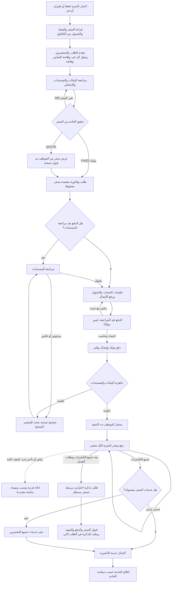

# B — رحلة العمرة وتجربة الاستخدام

## الخريطة الحالية والمطلوبة

الفروع ذات الخط المتقطع مقترحة وغير منفذة. لا ينتظر اكتمال تأشيرة فقط شراء تذكرة. لا يُفترض أن عرض تذكرة اختياري يجيز خصم مبلغ إضافي. QUOTE موجود فعليًا للتوافق القديم؛ لا تُحوّل الأسعار التطويرية إلى FIXED ولا تغيرها ضمن التدقيق.

## الحالات التي يراها العميل

الخادم ينتج `progress.umrah`: المرحلة، المعتمرون، ملفاتهم، الإجراء التالي، ومن عليه الإجراء. المصدر `backend/src/modules/umrah/umrah-journey.js` و`contact-request-progress/request-progress.js`. يعرض حاليًا سبع مراحل ويجمع التحويل ومراجعة الإيصال تحت «تأكيد الدفع»، بينما طلب المالك يميز ثماني مراحل. التحسين: فصل «مراجعة الدفع» و«تم اعتماد الدفع» بصريًا اعتمادًا على paymentStatus؛ لا إنشاء حالة محلية مستقلة. إظهار RECEIVED بالعربية «تم استلام الطلب» والإجراء المطلوب مع سبب قابل للتنفيذ، وعدم كشف rank أو codes للعميل.

## مقارنة مستقلة للواجهات

| الخطوة | الويب الحالي | Android الحالي | التحسين المحدد والأثر |
|---|---|---|---|
| الباقات | FeaturedUmrah + umrah-booking-section وميزات KIND/INCLUDED/EXCLUDED | screens/umrah + umrah-view من خدمات الخادم | عقد عرض واحد بالأنواع الثلاثة والعملة ووحدة السعر؛ إعلان واضح أن القيم تجريبية حسب إعداد الخادم |
| السعر | الإجمالي مؤكد ويرسله العميل للتحقق | fixedPricing؛ QUOTE بلا سعر ثابت وغير متاح للحجز عبر واجهة العمرة | لا وضع fallback ثابت. إذا السعر الإداري موجود لكن الوضع QUOTE، توضيح معنى السعر وفق قرار المالك؛ لا دمج PR قديم تلقائيًا |
| المعتمرون | Traveler rows + نسخة intakeData.travelers | نفس payload المنظم | الاسم وربط الجواز ضروريان؛ بقية حقول الاستخراج مراجعة/تأكيد حسب المتطلب، دون نسخ متكرر غير لازم |
| الضامن | هاتف وإقامة على مستوى الطلب، اتصال إضافي اختياري | نفس الطلب | فصل بطاقة الضامن عن بطاقة كل معتمر ومنع طلب الإقامة نفسها عدة مرات |
| الحفظ والرفع | localStorage + PATCH draft + upload ثم multipart جديد | localStorage للحقول وmultipart نهائي | U-03/U-04/U-06: استعادة خادمية واحدة، مفتاح دائم، ملفات محفوظة بمعرفاتها، توضيح «حُفظ على الخادم» مقابل «محفوظ على هذا الجهاز» |
| الجودة/OCR | مراجعة OCR وحقول قبل الإرسال موجودة | مكونات scan/quality في الحزمة | اختبار جواز معتم/لامع/مقصوص؛ quality hints لا تثبت صلاحية الجواز؛ تجنب رفض ملف قانوني بناءً على تقدير صورة فقط |
| الدفع | request-payment-step/payment-access | screens/request-payment | عرض المبلغ والعملة والحساب ونسخة الفاتورة؛ بعد الإيصال «قيد المراجعة»؛ رفض بسبب وزر إيصال بديل |
| المتابعة | umrah-journey-section داخل التتبع | umrah-journey-view | كلاهما يرسم حالة الخادم؛ إضافة رفض/تأخير المعتمر من الخادم، لا نصوص وهمية |
| التأشيرات | روابط deliverable منفصلة حسب التغطية | ملفات لكل pilgrim | لا اكتمال بمجرد ملف واحد؛ إضافة تنزيل جماعي مصرح به اختياريًا بعد تحقق ملكية كل ملف، وعدم تجميع جوازات خاصة ضمنه |
| التذاكر | طلب مرتبط بعد صدور التأشيرات | زر بحسب ticketBooking.available | ربط كل معتمر بالابن صراحة، والعودة إلى الأب والتسعير المنفصل؛ التمييز بين المشمولة والإضافية |
| الجلسة | cookies/تتبع/مسودة browser | bearer/session واستعادة محلية | اختبار انتهاء الجلسة خلال رفع، إعادة تسجيل دون إرسال طلب جديد، وعدم تخزين صور/أرقام حساسة بلا مدة |

الأدلة: `web/src/components/sections/service-intake-wizard.tsx:364,401,1100,1204`، `mobile/www/js/screens/intake.js:32,144,626`، `mobile/www/js/umrah-view.js:44`، `web/src/lib/umrah-package.ts:23`، `umrah-journey.js:40,76`.

## لوحة الإدارة

ليست الشاشة بحاجة إلى إعادة تصميم من الصفر. `web/src/components/admin/umrah/umrah-case-panel.tsx:103` يعرض الباقة والدفع والضامن والمراحل والمسؤول والمستندات والمعتمرين. `umrah-queue.tsx` يوفر بحثًا وفلاتر وصفوفًا متجاوبة. الإجراء التالي مشتق من `umrah-staff-queue.js`، والتدقيق/المهام موجودان في مساحة الحالة.

| الشاشة | المشكلة/القيد | المقترح | معيار الأثر |
|---|---|---|---|
| قائمة العمرة | فلترة أولوية محلية بعد pagination | stage/نوع/تنبيه/ترتيب على الخادم؛ إظهار الإجمالي الصحيح | طلب مستعجل قديم يظهر أولًا عبر >100 سجل |
| تفاصيل الطلب | nextAction يتطلب استعلام القائمة مرة أخرى (`umrah-case-panel.tsx:112`) | إضافته للاستجابة التفصيلية نفسها | استجابة واحدة متسقة للملخص والخطوة التالية |
| اعتماد الإيصال | الرابط يفتح `/admin/payment-review` دون requestId (`:156`) | فتح الإيصال المحدد في سياق الطلب للمحاسب | اعتماد/رفض دون إعادة البحث عن العميل |
| مستندات الفرد | انتقال بين ملخص ومستندات وسير عمل | بطاقة معتمر بأزرار مصرح بها؛ تبقى تفاصيل التدقيق قابلة للتوسيع | مراجعة ونشر مستند واحد ضمن الحالة نفسها |
| إصدار جزئي | لا سبب رفض/تأخير للفرد | بادجات نصية وتاريخ متابعة وإجراء مطلوب | لا يُعرض «جارٍ» دون تفسير إذا تعثر فرد |
| الضامن | التعرف على الإقامة عبر نص label (`:127`) | استخدام requirementId/attachmentType ثابت | تغيير اسم المستند لا يخفيه من بطاقة الضامن |
| التقارير | مؤشرات الصفحة ليست تقرير عمرة شاملًا | تجميع خادمي حسب النوع/المرحلة/الدفع والمدة | فصل عدد الطلبات وعدد المعتمرين والتأشيرات |

## العربية والإتاحة والأداء

الهوية الحالية تستعمل `--nh-*` للون والبطاقات والحالات، فتُحفظ. توجد labels، role=status، ونصوص مع الألوان في المكونات المفحوصة. الأرقام/الهواتف تستخدم dir=ltr داخل العربية. هذه أدلة مصدر وليست اجتياز WCAG. المطلوب تحقق 360/390/768/1440، تكبير 200%، لوحة مفاتيح، قارئ شاشة، تركيز بعد الخطأ، ترتيب RTL، وتباين الألوان الفعلي.

لا توجد قياسات Core Web Vitals أو اختبار جهاز Android فعلي لهذه الجولة. لا تُنسب لصور docs القديمة صفة فحص حالي. المرفقات الكبيرة وOCR المتزامن يحتاجان قياسًا منفصلًا قبل تقدير زمن الاستجابة. الرسائل الإنجليزية في بعض validator errors تُعرّب مع ربطها بالحقل، دون إخفاء 409 أو إعادة الإرسال آليًا على تغير السعر.
