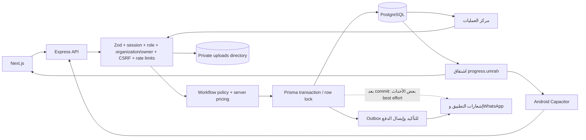

# C — تدفق البيانات الفعلي

قاعدة البيانات هي المصدر المقصود للحالة؛ localStorage ذاكرة استعادة لا مرجع مالي. التخزين المحلي في الخادم منفصل عن معاملات PostgreSQL، وهي فجوة اتساق لا تلغي حماية تنزيل الملفات.

## سجل العمليات

البادئة لجميع المسارات `/api`. المعاملة المذكورة تخص ما هو موجود فعليًا؛ «لا» لا تعني أن إضافة transaction حول القراءة وحدها تحل كل السباقات.

| البداية | endpoint | تحقق/صلاحيات | قراءة وكتابة/علاقة | المعاملة | الاستجابة والفشل/الاستعادة |
|---|---|---|---|---|---|
| اختيار الباقة في الموقع/الهاتف | GET `/services/public/packages`؛ checklist الخدمة | عام، نشر/تفعيل كتالوج وحدود API | Service + VisaRequirement؛ ميزات النوع نصية | قراءة | قائمة سعر/عملة/وحدة؛ خطأ شبكة يعرض إعادة محاولة لا سعرًا بديلًا |
| حفظ wizard الويب | POST `/intake-drafts` ثم PATCH `/:token` | Zod، scope إنشاء، token عشوائي، mutable expiry | IntakeDraft: بيانات/مسافرون JSON | writes منفصلة | draft/token ثم بيانات؛ 404/410/409؛ token محفوظ browser؛ خطر سجل URL U-01 |
| اختيار مستند في الويب | POST `/intake-drafts/:token/documents` | MIME signature + الحجم + requirement ownership | ملف، ContactRequestDocument.draftId، documentTravelerRefs | ليست وحدة ذرية | 201 docId؛ 400 MIME/size/maxFiles؛ retry قد يكرر الملف؛ سباق U-04 |
| إرسال الويب/الهاتف الحالي | POST `/contact-requests` multipart | Zod، خدمة مسموحة، requirement/معتمر، قبول سعر وعملة، submissionKey | ContactRequest + Traveler + Documents + Invoice + confirmation outbox | nested create ذري؛ التحقق/الملفات قبله | 201 id/paymentAccess؛ 409 price/key conflict؛ إعادة المفتاح نفسه تمنع تكرار الطلب |
| تحويل مسودة API المتاح | POST `/intake-drafts/:token/submit` | token + mutable + تسعير + خدمة | create request/travelers/invoice ثم نقل documents ثم claim draft | `$transaction` + updateMany claim | 201 أو 409 ALREADY_SUBMITTED؛ المسودة تقرأ قبل transaction؛ ليست الطريق النهائية في wizard العام |
| فتح الدفع بعد الإرسال | GET `/contact-requests/:id/payment-access` | X-Payment-Access من controller، hash+expiry ونطاق طلب | Invoice + ContactRequest + PaymentAccount | قراءة | السعر المثبت وaccounts/settlementOptions/version؛ 404 لا يكشف طلب الغير |
| رفع إيصال عبر رابط الدفع | POST `/contact-requests/:id/payment-access/receipt` | payment token + feature + MIME + settlement/version | financial ContactRequestDocument + UNDER_REVIEW | `recordPaymentReceipt` تحت قفل الطلب | إيصال قيد المراجعة فقط؛ تغير فاتورة/حالة يرفض، تحديث الشاشة قبل إعادة المحاولة |
| استعادة التتبع | POST `/tracking/request-code` و`/verify-code` ثم GET `/tracking/requests` | rate limit وOTP/session ونطاق الهاتف | ContactRequestLoginCode وطلبات هاتف المستخدم | بحسب العملية | جلسة ومعلومات محسوبة؛ لا البحث بهاتف عميل آخر من المدخل المحلي |
| حساب العميل | GET `/customer/requests` و`/:id` | requireCustomerAuth، customerId | طلبات العميل وملفات منشورة | قراءة | progress/checklist؛ session expired يحتاج إعادة المصادقة |
| تصحيح مستند | POST `/tracking/requests/:id/documents` أو `/customer/requests/:id/documents` | owner + traveler belongs to request + requirement + signature | إصدار جديد ContactRequestDocument، supersededAt للقديم المرفوض | write تحت قفل؛ count قبله U-05 | docId/current checklist؛ رفض المغلق أو ملف الغير؛ سعة الملفات تُعاد تحت القفل في الإصلاح |
| قائمة الموظف/تفاصيله | GET `/contact-requests` و`/:id` | staff role + organization؛ assignment فلتر وليس ACL حصريًا | request/invoice/travelers/docs/tasks/assignee | قراءة paginated | data/meta/progress/queue؛ بعض sort/filter عميل فقط U-10 |
| مراجعة جواز | PATCH `/contact-requests/:id/documents/:documentId/status` | عمليات/مدير، المؤسسة، policy | document review + audit/tasks | مسار policy/قفل حيث تطبقه الخدمة | ACCEPTED/REJECTED وسبب؛ حدث مطلوب من العميل |
| تأكيد/رفض الإيصال | POST `/contact-requests/:id/confirm-payment` أو `/reject-payment` | FINANCE فقط + المؤسسة + feature + policy | Request paymentStatus، receipt document reviewer/time، PaymentReceipt، outbox، ActivityLog | `withLockedRequest` + audit atomically | قبول مرة واحدة؛ loser 409؛ رفض يعيد AWAITING_TRANSFER مع سبب |
| بدء التنفيذ | POST `/contact-requests/:id/start-execution` | عمليات/مدير + readiness + دفع | executionStartedAt/By + audit | قفل صف الطلب | IN_EXECUTION؛ رفض المستند الناقص والدفع غير المعتمد |
| تجهيز/نشر تأشيرة | POST `/contact-requests/:id/deliverables` ثم `/:id/deliverables/:deliverableId/publish` | الدور/المؤسسة + PAYMENT/execution + coverage | ContactRequestDeliverable، coverage، audit، completeIfDone | قفل + نشر + إكمال ذري؛ الملف خارجه | draft غير ظاهر؛ نشر جزئي لا يكمل الكل؛ إخفاق إشعار بعد commit لا ينبغي أن يعني إعادة رفع |
| تنزيل تأشيرة | GET `/tracking/requests/:id/deliverables/:deliverableId/file` أو account equivalent | جلسة + ملكية الطلب + published/non-superseded | deliverable metadata → resolveStoredUploadPath | قراءة + stream | 404 للغير/المسودة؛ إعادة GET آمنة، لا رابط تخزين عام |
| تذكرة اختيارية | POST `/tracking/requests/:id/umrah/tickets` أو `/customer/requests/:id/umrah/tickets` | نطاق العميل + صدور جميع التأشيرات + غير ملغى/مرفوض | ContactRequest ابن، parentRequestId/linkKind، Traveler جديد | قفل الأب وunique(parent,kind) | 201 created أو 200 existing؛ معالجة طلب الابن بعرض سعر وخدمات الحجز الموجودة |
| إنهاء الحالة | نشر آخر مخرج أو PATCH status | policy DELIVERY لكل فرد/الخدمات والدفع | outcome/closedAt + audit | completeIfDone داخل transaction | لا إكمال جماعي بسبب تأشيرة فرد؛ شروط الباقة الحية مشكلة U-02 |

## المراجع الرئيسية

- تركيب المسارات: `backend/src/routes/index.js:53–89`.
- مسارات الموظف: `backend/src/modules/contact-requests/contact-requests.routes.js:138–330`؛ النشر قرب نهاية الملف.
- العميل: `contact-request-tracking/contact-request-tracking.routes.js:47–71` و`customer-portal/customer-portal.routes.js:21–27`.
- الحفظ: `intake-drafts/intake-drafts.service.js:77,104,122,159,274,339`.
- تسعير: `contact-request-pricing/fixed-price.js:82–155`.
- معاملة: `contact-request-workflow/workflow-lock.js:46–76`؛ دفعة `contact-requests.service.js:1038–1115`.
- التسليم: `contact-request-deliverables/contact-request-deliverables.service.js:31–174`.

## أخطاء الترتيب والتزامن التي يجب اختبارها

1. قبول ورفض الإيصال معًا: قفل واحد؛ حدث مالي واحد، audit واحد، ويقرأ الخاسر الحالة الجديدة.
2. نشر تأشيرة وإلغاء الطلب معًا: أحدهما فقط مسموح بعد إعادة قراءة policy؛ لا يُقاس ذلك باختبارات pure.
3. رفع مستندين متزامنين: فحص السعة الحالي خارج قفل الطلب؛ إصلاح U-05 وإعادة count تحته.
4. autosave متأخر بعد submit: البيانات السابقة لا يجوز أن تتحول إلى الطلب إذا رفع مستند لاحقًا؛ token يتوقف عن التعديل بعد claim مع قفل المسودة.
5. ضياع HTTP response بعد commit: استخدام مفتاح دائم وGET نتيجة العملية، وعدم إنشاء طلب جديد بالاسم/الهاتف فقط.
6. تغيير الباقة بعد قبول السعر: تثبيت النوع/المشمولات إضافةً للسعر؛ الاحتفاظ بالمصدر الحالي للكتالوج للطلبات الجديدة فقط.
7. انقطاع العملية بين DB ونظام الملفات/الإشعار: staging file + reconciliation/outbox وإعادة آمنة، دون حذف عشوائي لأي ملف قد يشير إليه سجل حي.

لا يوجد قياس فعلي لفشل الشبكة في متصفح أو Android بهذه الجولة. هذه حالات قبول لإعادة التنفيذ في بيئة معزولة، وليست ادعاء مرور اختبار.
