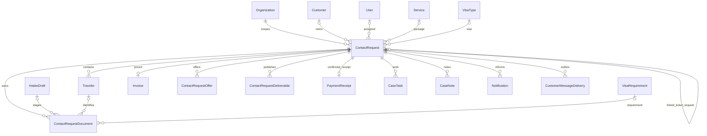

# D — PostgreSQL وPrisma

## نطاق الدليل

فُحص `backend/prisma/schema.prisma` والمهاجرات المتصلة بالعمرة والمسودات والمستندات والدفع. لم يُفتح اتصال بقاعدة إنتاج، ولم تُفحص بيانات حقيقية. أسماء الكيانات أدناه موجودة في Prisma؛ لا تُنشأ جداول UmrahRequest أو Pilgrim أو Payment أخرى لمجرد اختلاف الاسم التجاري.

## المخطط الحالي



المخطط يصف العلاقات الموجودة، وليس كل ضماناتها: تغطية deliverable→Traveler مصفوفة IDs بلا FK، وIntakeDraft→submittedContactRequestId ليس relation رغم أنه فريد. ActivityLog سجل عام entity/entityId وليس FK خاصًا بكل طلب. UmrahGroup/UmrahGroupMember يرتبطان بـCustomer/Order لتنظيم المجموعات؛ ليسا بديلًا عن Traveler في رحلة ContactRequest الحالية.

| الكيان الحالي وموقعه | الغرض والضمان الموجود | القيد/الملاحظة |
|---|---|---|
| Organization:130، User:395، Customer:443 | مفاتيح رئيسية، مؤسسة، أدوار، جلسات | علاقات منفصلة لا تضمن أن الموظف والعميل والطلب من المؤسسة نفسها داخل DB وحدها |
| Service:505، VisaType:568 | سعر Decimal ووضع/وحدة، بيانات الكتالوج | نوع العمرة داخل features كنص KIND؛ لا لقطة خدمة تاريخية كاملة |
| VisaRequirement:638 | نطاق CASE/TRAVELER ومتطلبات وMIME/maxFiles | ملكية الخدمة/التأشيرة تحتاج exclusivity؛ المتطلبات التاريخية في JSON snapshot مناسبة |
| ContactRequest:1266 | submissionKey/payment token hash unique، FK للمؤسسة والعميل والخدمة، parent/linkKind unique | payment/status وoutcome مفاهيم منفصلة، تفسرها policy؛ لا تحويلها إلى enum واحدة عمياء |
| Traveler:1405 | FK للطلب، وثائق لكل فرد، sortOrder/isPrimary | لا قيد unique للـprimary، لا حالة فردية للتأشيرة؛ جواز نفس الفرد في طلب آخر ليس خطأ عالميًا |
| IntakeDraft:1462 | token unique، submittedRequest unique، expiry index | token خام، submittedRequest بلا FK؛ JSON refs معرضة lost update |
| ContactRequestDocument:1498 | FK طلب/مسودة/معتمر/متطلب/مراجع، versions عبر supersededAt | لا قيد يوجب مالكًا واحدًا فقط request XOR draft؛ لا FK مركب يثبت تطابق طلب المعتمر |
| ContactRequestDeliverable:1589 | FK الطلب ورافع الملف، kind، نشر، array coverage | publishedByUserId scalar بلا relation؛ travelerIds بلا FK، version لا يكفي وحده لمنع تداخل الملفات |
| Invoice:1657 | contactRequestId unique، Decimal(12,2)، version وصرف مجمد | المالي في ContactRequest يختلف عن Payment المرتبط بـOrder؛ لا تكرار المدفوعات في جدولين |
| PaymentReceipt:1807 | مستند اعتماد الدفع النهائي، مرتبط بالطلب | ليس صورة التحويل؛ لا تخلطهما في تقارير المقبوضات |
| Payment:884، Order:708، OrderItem:834 | مسار أوامر مالي آخر موجود | لا تفترض أن كل طلب عمرة له Order تلقائيًا؛ يلزم عقد ربط إن احتاجت المحاسبة ذلك |
| ActivityLog:1175، Notification:953، CustomerMessageDelivery:1723 | تدقيق، إشعارات، outbox فريد للطلب/نوع/قناة | outbox تأكيد وإيصال موجود؛ إشعارات مراحل أخرى best-effort |

## المشكلات والفهارس

الـPK موجودة في كل نموذج مفحوص، وFK والفهارس الفردية موجودة بكثرة؛ الادعاء «قاعدة بلا علاقات» غير صحيح. `ContactRequest` لديه فهارس organization/status/createdAt/assignedUser/service/customer، و`Document` لديه request/draft/traveler/requirement. لا دليل EXPLAIN على فهرس مفقود يسبب بطئًا فعليًا، لكن نمط قائمة المؤسسة والحالة والتاريخ يستحق فهرسًا مركبًا.

| التغيير المقترح | السبب | الأثر والتوافق |
|---|---|---|
| `ContactRequest.serviceSnapshot` JSON versioned | تثبيت KIND والشمول والاستثناءات وقت قبول الطلب U-02 | additive؛ الخادم يفضل snapshot ثم legacy fallback معلّم، الواجهات القديمة تبقى قابلة للقراءة |
| جدول تغطية مخرجات مقترح `DeliverableTraveler` | FK لكل تغطية بدل مصفوفة غير محمية | dual-read/write مؤقتًا مع travelerIds للنسخ القديمة؛ لا حذف العمود في الإصدار الأول |
| FK مركب `(travelerId,contactRequestId)` للمستند/التغطية | منع معتمر من طلب آخر عند مستوى DB | إضافة unique مرجعي `(id,contactRequestId)` على Traveler، وفحص null/CASE scope أولًا |
| FK nullable للمسودة submittedContactRequestId | منع orphan submitted references | relation بلا حذف تلقائي لسجل التدقيق؛ افحص القديمة قبل validation |
| CHECK مالك المستند request XOR draft | منع ملف بلا مالك أو بمالكين | `NOT VALID` ثم quarantine/backfill ثم VALIDATE؛ لا تفترض كل القديمة سليمة |
| partial unique لواحد isPrimary لكل طلب | سلامة شخصية مقدم الطلب إن استُخدمت | لا يفرض وجود primary؛ طلب شخص آخر جائز |
| CHECK sizeBytes>0، travelerCount>0 إذا موجود، amount>0 وفق سياسة الفاتورة | دفاع DB إضافي | افحص مسارات صفر/استرداد القديمة؛ لا تفرض منع السالب على Ledger كله |
| index `(organizationId,status,createdAt,id)`، وربما `(organizationId,paymentStatus,createdAt,id)` | قائمة الموظف وفرز ثابت | قياس EXPLAIN على synthetic 10k/100k قبل الاعتماد؛ لا تضف كل الاحتمالات |
| index documents `(contactRequestId,requirementId,travelerId)` للنسخ الحالية | عد ملفات المتطلب/الفرد | partial حيث supersededAt IS NULL إن أثبت القياس؛ يحافظ على historical reads |
| أصل معتمر التذكرة `sourceTravelerId` أو junction | U-11، هوية لا أسماء | FK يتأكد أن المصدر من parent؛ لا نقل جواز تلقائي دون ضرورة |

الحذف الحالي Cascade من الطلب إلى المسافرين والمستندات والفواتير، وSetNull من خدمات/عملاء إلى الطلب. تغيير حذف الإنتاج ليس ضمن التدقيق. المقترح إغلاق/أرشفة الطلب المالي والوثائق مع retention مضبوط، وحصر الحذف في إجراء إداري مدقق. cascade لا يحذف ملف القرص تلقائيًا.

## ما يبقى JSON وما ينظم

- يبقى `requirementsSnapshot` و`pricingSnapshot` كوثيقة تعاقد تاريخية لا تتبدل مع القوالب. أضف schemaVersion وتحققًا خادميًا.
- تبقى الإجابات الديناميكية وOCR/quality hints JSON؛ ليست بيانات جواز معتمدة دون مراجعة.
- `intakeData.travelers` نسخة توافق قديمة بجانب Traveler. لا تحذفها الآن؛ حدد القراء أولًا، ثم اجعل الكتابة من مصدر منظم واحد وتحقق consistency.
- الضامن حاليًا JSON + مستند CASE. ليس ضروريًا إنشاء كيان Sponsor عالمي؛ بياناته خاصة بكل طلب. حقول typed اختيارية فقط إذا احتجنا بحثًا/قيودًا محددة.
- تُنظم تغطية التأشيرات وربط المسافر بالتذكرة لأنهما علاقات تتطلب FK واستعلامات، لا لمجرد وجود JSON/array.
- لا دليل كافٍ لتصنيف جداول أو حقول بأنها غير مستخدمة اعتمادًا على الاسم؛ يلزم فهرس جميع القراء والكتّاب قبل الإزالة.

## مثال migration إضافي اختُبر ضمن transaction مع تراجع

```sql
-- تعليمية للمراجعة، ليست migration جاهزة للإنتاج.
ALTER TABLE "ContactRequest" ADD COLUMN "serviceSnapshot" JSONB;
ALTER TABLE "ContactRequestDocument"
  ADD CONSTRAINT "document_one_owner"
  CHECK (("contactRequestId" IS NOT NULL) <> ("draftId" IS NOT NULL)) NOT VALID;
ALTER TABLE "IntakeDraft"
  ADD CONSTRAINT "draft_submitted_request_fk"
  FOREIGN KEY ("submittedContactRequestId") REFERENCES "ContactRequest"("id")
  ON DELETE RESTRICT NOT VALID;
-- VALIDATE فقط بعد فحص/تصحيح البيانات في بيئة معزولة.
```

اختُبر هذا الجزء فقط في `migration-probe.sql` على قاعدة اصطناعية مستعادة: نجحت إضافة/تحقق القيود ورفض المخالفات ثم ROLLBACK، وتأكد غياب العمود بعده. ليس ترحيل Prisma كاملًا ولا اختبار backfill أو إنتاج. إنشاء جدول التغطية/العلاقات المركبة يحتاج Prisma models وSQL متوافقين واختبارات قبل إدراجه في migrations. ينفذ CREATE INDEX CONCURRENTLY بخطوة منفصلة إن اختير، لا داخل transaction محظورة لذلك الأمر.

## خطة الانتقال الآمنة

1. إنشاء PostgreSQL معزول بنسخة مدعومة، بدون أي DATABASE_URL إنتاج، وتشغيل المهاجرات الحالية والseed ببيانات اصطناعية فقط.
2. fixtures: طلب تأشيرة/طيران/بحر، عدة أفراد، ملف جماعي، تغطية ناقصة/خارجة، مسودة منتهية/مقدمة، ملف orphan، حالة مدفوعة، ونوع قديم غير معلوم. لا تضع بيانات حقيقية في Git.
3. فحص orphan/duplicate/cross-request/count mismatch وإخراج أعداد فقط. حالات غامضة إلى جدول/تقرير quarantine، لا guessing ولا حذف.
4. إضافة الأعمدة والجداول nullable والقيود NOT VALID، ثم نشر قراءة متوافقة وdual-write. لا تبدل الأسعار.
5. backfill batch keyed cursor، قابل لإعادة التشغيل، وتسجيل الإصدار وعدد الصفوف. لا تستنتج عقد طلب قديم من كتالوج اليوم بوصفه حقيقة تاريخية؛ سجل provenance=legacy/current-inferred واستلزم مراجعة الحالات الحساسة.
6. مقارنة التغطية القديمة والجديدة، قبول صفر dangling FK وصفر cross-request mapping وصفر تغيير مالي. السماح بصفوف quarantine يمنع تفعيل المصدر الجديد لها.
7. VALIDATE القيود وتبديل القراءة بميزة تدريجية، مع مقاييس رفض 409/404 وفروق التغطية.
8. rollback المبكر: إيقاف الميزة والعودة للقراءة القديمة مع الإبقاء على البيانات الإضافية. بعد كتابة بيانات لا يفهمها الإصدار القديم: roll-forward، لا DROP تلقائي ولا down migration تفقد المخرجات.

معيار الاختبار: إعادة migration/backfill لا تضاعف rows؛ ترقية من مخطط SHA المفحوص؛ رفض cross-tenant/cross-request؛ تزامن تحويل/رفع المسودة؛ استعادة backup إلى قاعدة أخرى والتحقق من القيود وعدد السجلات وتغطية ملفات القرص.

## حماية البيانات والنسخ الاحتياطي

الملفات محمية بمسارات تنزيل مصادق عليها وليست express.static للuploads. يجب التحقق تشغيليًا من تشفير القرص/النسخ، صلاحيات الخدمة، TTL للرموز، منع تسجيل paths الحاملة للtokens، وسياسة الاحتفاظ/المحو المدقق. لا يكفي إخفاء جواز في API إذا ظهر في اسم ملف بالسجل.

يوجد drill في `.github/workflows/ci.yml` لقاعدة PostgreSQL 16 صناعية و`scripts/release-restore-drill.sh`، وتعليمات rollback في docs. وجود السكربت ليس إثبات نجاح آخر نسخة احتياطية للإنتاج. قبل migration إنتاجية: موافقة صريحة، backup PostgreSQL وuploads في نقطة متسقة، manifest بأحجام/checksums، استعادة معزولة ناجحة، تحقق المراجع والملفات والوظائف المالية، وقياس RPO/RTO. يحدد المالك المستهدف؛ لا تُفترض قيم SLA من الكود.
